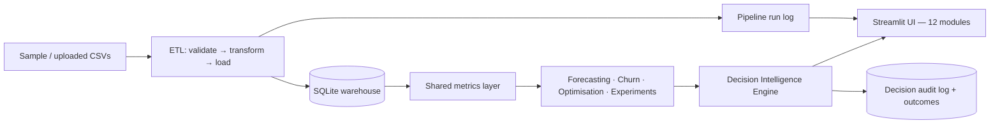

# CORTEXORA

**The Intelligence Engine for Predictive Business Decisions**
*Predict the Future. Optimize the Present. Engineer Business Growth.*

CORTEXORA is an integrated retail decision-intelligence platform that connects the full analytical chain in one product:

**What happened? → Why? → What next? → What should we do? → Did it work?**

Raw transactions flow through a validated ETL into a SQLite warehouse; a single metric-definition layer feeds forecasting, churn prediction, pricing/inventory/marketing optimisation and an experimentation lab; a Decision Intelligence Engine turns those outputs into prioritised, evidence-based recommendations that a human approves, and then tracks whether they actually worked.

> ⚠️ **Data honesty:** everything currently runs on clearly-labelled **synthetic demo data** (deterministic, seed=42). No figure in this project is presented as a real business result. The architecture, tests and methods are the deliverable; swap in a licensed real dataset via the same pipeline (see `docs/04_DATASET_STRATEGY.md`).

## Quickstart
```bash
python -m venv .venv && .venv/bin/pip install -r requirements.txt
.venv/bin/python scripts/run_etl.py      # generate sample -> validate -> load warehouse
.venv/bin/streamlit run app.py           # or just this: the app auto-bootstraps on first run
.venv/bin/python -m pytest -q            # 34 tests
.venv/bin/python scripts/train_churn.py  # reproduce churn model + evaluation artifact
```
Docker: `docker build -t cortexora . && docker run -p 8501:8501 cortexora`

## What is implemented (all verified by tests / in-app execution)
| Area | Capability |
|---|---|
| Executive & Growth BI | Live KPIs, period-over-period comparison, category/region analysis, drill-down + CSV export |
| Demand Forecasting | Weekly forecasts with 80% interval, chronological hold-out vs seasonal-naive baseline (MAE/RMSE/WAPE) |
| Inventory | Forecast-based reorder plan: safety stock (95% service level), order cost, stockout risk, margin $ at risk |
| Customer Intelligence | RFM segmentation + **validated churn classifier** (leakage-tested label, dummy-baseline comparison, model card) |
| Pricing & Profit | Assumption-based price simulator, observed discount-effectiveness, break-even analysis |
| Marketing | CAC proxy, fitted diminishing-returns response curves, **constrained budget optimizer** (reliability-gated), MMM **readiness gate** |
| Experiments & Causal Lab | A/B analyser (effect, CI, Cohen's h, SRM check), sample-size planner, difference-in-differences |
| Competitor Intelligence | Strictly-validated user-supplied price snapshots, undercut alerts, downloadable reports (no fake live feed) |
| Decision Engine | Evidence-linked recommendations, transparent priority formula, approve/reject/defer with owner + measurement period, **expected-vs-actual outcome tracking & calibration** |
| Monitoring | Data-quality gates, pipeline run log, PSI drift, temporal model-performance monitoring, model version metadata |
| Reports | Downloadable executive report rendered from the same computed values as the dashboards |

## Architecture


## Repository structure
```
app.py                  Streamlit application (12 modules)
cortexora/              analytics/ (metrics, experiments, competitor) · models/ (forecasting, churn)
                        optimization/ · decision_engine/ · monitoring/ (quality, drift) · pipelines/ (ETL)
                        data/ (synthetic generator) · reports/
database/schema.sql     warehouse schema (grains documented in docs/03)
scripts/                run_etl.py · train_churn.py
tests/                  34 pytest tests: metrics, leakage, forecasting, optimisation, experiments, decisions, monitoring, ETL
docs/                   PRD, architecture, data model & metrics, dataset strategy, roadmap,
                        model card, per-phase methods & limitations (01–11)
```

## Key documents
`docs/01_PRD.md` · `02_ARCHITECTURE.md` · `03_DATA_MODEL_AND_METRICS.md` · `04_DATASET_STRATEGY.md` (licensing) · `05_ROADMAP.md` · `06_MODEL_CARD_CHURN.md` · `11_DEPLOYMENT_AND_DEMO.md` (incl. a 10-minute demo script)

## Limitations & future work (stated, not hidden)
- Synthetic data only so far; recommended next step is UCI Online Retail II (CC BY 4.0) through the same ETL, then retraining/re-evaluating the churn model.
- MMM *fitting* is deliberately disabled until a revenue outcome joinable to weekly channel spend exists — the readiness gate explains exactly what's missing.
- RetainIQ churn integration is pending access to that repository; the customer-intelligence layer is model-agnostic by design.
- SQLite is the local/demo store; the schema is kept portable for Postgres.
- Screenshots intentionally not committed — capture them from your own deployment (guide in docs/11) rather than trusting generated images.
